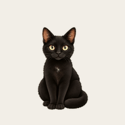

# Sombra

A calm, curious black cat with green-gold eyes, made as an animated companion.



## Install Sombra

With Codex desktop installed and pet installation available, copy this entire link into your browser's address bar and allow it to open Codex:

```text
codex://pets/install?name=Sombra&imageUrl=https%3A%2F%2Fraw.githubusercontent.com%2Frubyoles%2Fsombra-pet%2Fmain%2Fsombra.png&description=A%20calm%2C%20curious%20black%20cat%20with%20green-gold%20eyes.&spriteVersionNumber=2
```

Follow the pet installation flow in the app. GitHub may filter clickable `codex://` links, so the complete link is provided above as copyable text.

You can also [download the original sprite sheet](https://raw.githubusercontent.com/rubyoles/sombra-pet/main/sombra.png). Use `sombra.png` for installation; `preview.gif` is only an animation preview.

## Files

- `sombra.png` — the original transparent v2 animation sprite sheet.
- `preview.gif` — a preview made from the original six idle frames.
- `preview.png` — a still preview.
- `metadata.json` — descriptive metadata and the original file checksum; this is not an installation manifest.

## Format and verification

The sprite sheet is a transparent PNG, 1536 × 2288 pixels, with 192 × 208 cells and the v2 animation layout. It passed the Pets plugin sprite-sheet validator before packaging. The preview and sprite sheet are different files: install the PNG sprite sheet, not the preview GIF.

## Documentation

- [Codex pet install links](https://learn.chatgpt.com/docs/reference/commands#pets)
- [Pets and supported interfaces](https://learn.chatgpt.com/docs/pets)

